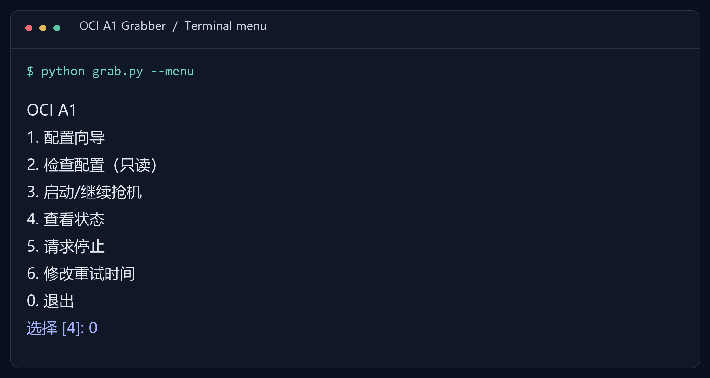

# OCI A1 Grabber

**English** · [简体中文](README.zh-CN.md)

Retry Oracle Cloud Ampere A1 instance creation on your schedule. Configure once, set an interval in minutes, and stop automatically after one instance is ready.


[](LICENSE)

[Quick start](#quick-start) · [Timing](#set-your-timing) · [Full guide](docs/USAGE.en.md) · [FAQ](#faq)



*Preview rendered from actual program output. CLI prompts are currently in Chinese; commands and configuration keys use English.*

## What it does

- **Choose your pace.** Set a retry interval and an optional total runtime in minutes.
- **Import your configuration.** Paste the Oracle configuration preview or load an OCI profile. Select an existing subnet by number.
- **Resume after interruption.** Reconcile existing instances and preserve tokens for unconfirmed requests.
- **Check the process.** View status, attempt counts and logs, or request a stop.

A small Python CLI using the official OCI SDK. No web server, database or AI service to configure.

## Quick start

### 1. Prepare

Install **Python 3.10+**, then download and extract this repository using **Code → Download ZIP**.

Have a registered **Oracle API signing key** and its local `.pem` private key, an **SSH public key** (`.pub`), and an existing **public subnet in the root compartment of your tenancy's home region** ready. [Oracle API key setup →](https://docs.oracle.com/en-us/iaas/Content/API/Concepts/apisigningkey.htm)

### 2. Open the menu

| Windows | Linux / macOS |
| --- | --- |
| Double-click `start.cmd` | Run `sh start.sh` |

The launcher creates a local Python environment and installs dependencies on first use.

### 3. Configure → check → start

Choose **1 → 2 → 3**:

| Menu option | Action |
| --- | --- |
| **1** | Configure credentials, SSH public key, subnet and timing |
| **2** | Validate the account and resources without creating anything |
| **3** | Start or resume creation attempts |

Keep the computer awake and the foreground terminal open. Press `Ctrl+C` to stop and return to the menu. [Background operation →](docs/USAGE.en.md#background-operation)

## Set your timing

Choose **6** to change timing without re-entering credentials. Stop the task before editing, then start it again.


*Real timing prompts with demonstration inputs: 2.5-minute interval, 120-minute runtime.*

Or edit `config.ini`:

```ini
[retry]
interval_minutes = 2.5
max_minutes = 120
```

The interval accepts **1–60 minutes**, including decimals. Runtime accepts **0** for unlimited, otherwise at least **1 minute**. By default, each wait adds 0–30 seconds of jitter; throttling triggers backoff. The interval is a wait after each round, not a fixed wall-clock schedule.

Override one run without changing the configuration:

```sh
python grab.py --resume --interval-minutes 3 --max-minutes 180
```

## Everyday commands

```sh
python grab.py --setup     # Configuration wizard
python grab.py --check     # Read-only validation
python grab.py --status    # Process status and attempts
python grab.py --stop      # Request a stop
```

Use an environment with dependencies installed, or replace `python grab.py` with `start.cmd` / `sh start.sh`. Logs: `runtime/grab.log`. Saved result and public IP: `runtime/state.json`.

## Scope

Default: **A1 · 2 OCPU · 12 GB RAM · 50 GB boot disk · Oracle Linux 9**. The wizard also offers 1 OCPU / 6 GB. Region and subnet are configurable; the region must be the tenancy's home region.

The tool uses an existing network and one selected availability domain. Existing A1 instances and disk usage are checked, but availability and zero charges are not guaranteed. Verify your account against [Oracle's current Always Free terms](https://docs.oracle.com/en-us/iaas/Content/FreeTier/freetier_topic-Always_Free_Resources.htm). [Limits and recovery →](docs/USAGE.en.md#scope-and-limits)

## FAQ

**Will it run after I close the terminal or restart?**

Foreground operation stops. Background operation is supported, but automatic restart and startup scheduling are not installed by this tool.

**Does a successful configuration check mean capacity is available?**

No. It validates credentials and required resources. Oracle determines capacity when an instance is requested.

**Can I delete the state file to restart?**

Keep it. It records pending requests and accepted instances to reduce duplicate creation. Resume the task and follow any reconciliation error instead.

## Contribute

Bug reports, clearer setup instructions and translations are welcome. Include your OS, Python version, command and a redacted error in an issue. Do not post credentials or full runtime state.

```sh
python -m unittest discover -s tests -v
python tools/build_release.py
```

The source release is written to `dist/oci-a1-grabber.zip`, excluding personal configuration, keys, logs and runtime files. The included CI runs offline tests; it does not create cloud instances.

## License

[Apache-2.0](LICENSE). Distribution notices are in [NOTICE.txt](NOTICE.txt).
