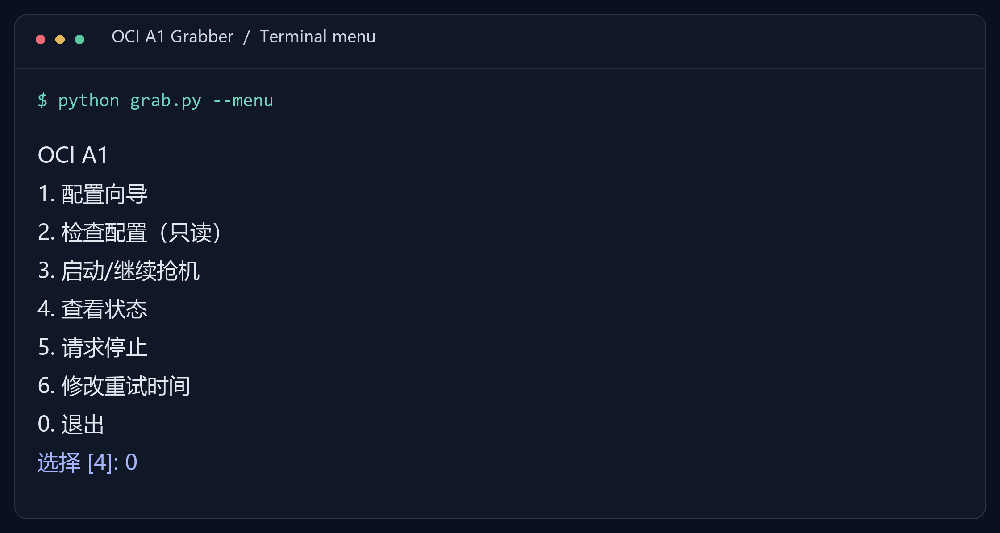
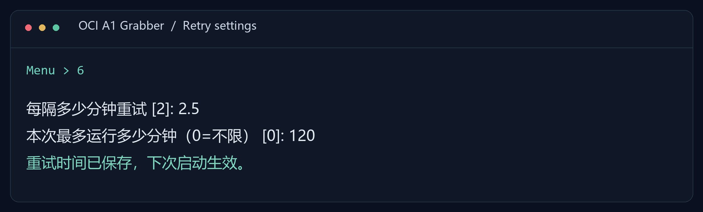

# OCI A1 Grabber

[English](README.md) · **简体中文**

按你设定的时间，自动重试创建 Oracle Cloud Ampere A1 实例。配置一次，按分钟重试，成功一台后自动停止。


[](LICENSE)

[快速开始](#快速开始) · [时间设置](#设置重试时间) · [完整指南](docs/USAGE.zh-CN.md) · [常见问题](#常见问题)



*根据程序实际输出渲染的终端预览。当前交互提示为中文，命令和配置字段使用英文。*

## 能做什么

- **按分钟设置。** 自定义重试间隔，也可以限制本次最长运行时间。
- **导入账户配置。** 粘贴 Oracle 配置预览或导入 OCI Profile，按编号选择现有子网。
- **中断后继续。** 核对已有实例，为结果尚未确认的请求保留重试令牌。
- **随时查看状态。** 查询进程是否运行、尝试次数和日志，或请求停止。

基于 Oracle 官方 SDK 的轻量 Python 命令行工具，无需配置网页服务、数据库或 AI 服务。

## 快速开始

### 1. 准备

安装 **Python 3.10+**，在仓库页面选择 **Code → Download ZIP** 下载并解压。

准备好已注册的 **Oracle API 公钥及配对的本地 `.pem` 私钥**、用于登录的 **SSH 公钥**（`.pub`），以及**租户主区域、根 compartment 下的现有公网子网**。[Oracle API 密钥配置说明 →](https://docs.oracle.com/en-us/iaas/Content/API/Concepts/apisigningkey.htm)

### 2. 打开菜单

| Windows | Linux / macOS |
| --- | --- |
| 双击 `start.cmd` | 运行 `sh start.sh` |

首次启动会建立独立 Python 环境并安装依赖。

### 3. 配置 → 检查 → 启动

依次选择 **1 → 2 → 3**：

| 菜单选项 | 操作 |
| --- | --- |
| **1** | 填写账户、SSH 公钥，选择子网和重试时间 |
| **2** | 只读检查账户与资源，不创建服务器 |
| **3** | 开始或继续创建重试 |

保持电脑开机、不休眠，前台运行时保持终端打开。`Ctrl+C` 停止并返回菜单。[后台运行方法 →](docs/USAGE.zh-CN.md#后台运行)

## 设置重试时间

菜单选 **6** 就能单独修改时间，不必重填账户信息。修改前先停止任务，保存后再次启动。



*真实时间设置提示，使用演示输入：间隔 2.5 分钟，运行时长 120 分钟。*

也可以编辑 `config.ini`：

```ini
[retry]
interval_minutes = 2.5
max_minutes = 120
```

重试间隔为 **1–60 分钟**，支持小数；运行时长 **0** 表示不限，否则至少 **1 分钟**。默认每轮额外随机等待 0–30 秒，遇到限流会延长等待。间隔从上一轮完成后计算，不是按固定整点执行。

也可以只修改本次运行参数，不改配置文件：

```sh
python grab.py --resume --interval-minutes 3 --max-minutes 180
```

## 常用命令

```sh
python grab.py --setup     # 配置向导
python grab.py --check     # 只读检查
python grab.py --status    # 进程状态与尝试次数
python grab.py --stop      # 请求停止
```

使用已安装依赖的 Python 环境，或将 `python grab.py` 换成 `start.cmd` / `sh start.sh`。运行日志位于 `runtime/grab.log`，创建结果和公网 IP 位于 `runtime/state.json`。

## 适用范围

默认配置：**A1 · 2 OCPU · 12GB 内存 · 50GB 启动盘 · Oracle Linux 9**，向导也可选择 1 OCPU / 6GB。区域和子网可配置，区域必须与租户主区域一致。

复用现有网络，在一个选定的可用区尝试创建。程序会检查已有 A1 和磁盘用量，但不保证有货或绝对零费用；请核对账户与 [Oracle 最新 Always Free 说明](https://docs.oracle.com/en-us/iaas/Content/FreeTier/freetier_topic-Always_Free_Resources.htm)。[限制与恢复说明 →](docs/USAGE.zh-CN.md#当前范围)

## 常见问题

**关闭窗口或重启电脑，还会继续吗？**

前台运行会停止。可以使用后台运行方式，但程序不会自动安装重启恢复或开机启动任务。

**“检查通过”就代表有库存吗？**

不是。检查只验证凭据和必要资源，创建时是否有容量由 Oracle 决定。

**能删除状态文件重新开始吗？**

请保留状态文件。它记录未确认请求和已经接受的实例，用于减少重复创建。使用继续运行命令，遇到核对提示时先检查云端结果。

## 参与改进

欢迎反馈问题、完善配置说明或贡献翻译。提交 Issue 时请附上操作系统、Python 版本、执行命令和脱敏后的错误信息，不要上传凭据或完整运行状态。

```sh
python -m unittest discover -s tests -v
python tools/build_release.py
```

源码包输出到 `dist/oci-a1-grabber.zip`，排除个人配置、密钥、日志和运行状态。仓库中的 CI 只运行离线测试，不会创建云服务器。

## 许可证

[Apache-2.0](LICENSE)。分发声明见 [NOTICE.txt](NOTICE.txt)。
